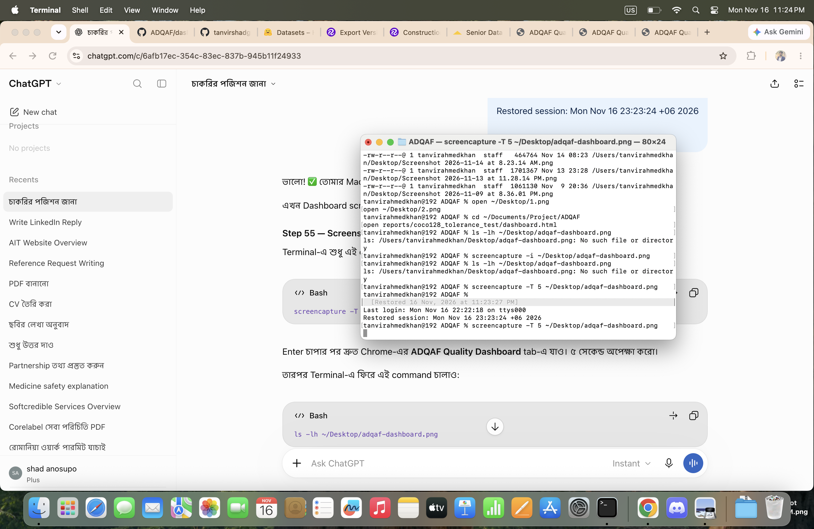

# ADQAF — Autonomous Data Quality Assurance Framework

A Python-based prototype for automated quality assurance of YOLO object-detection datasets.

ADQAF demonstrates annotation validation, dataset integrity checks, automated quality gates, regression testing, and HTML reporting.

**Status:** Functional research and engineering prototype. Not production-certified.

## Features

- YOLO bounding-box validation
- Invalid class ID detection
- Non-numeric and non-finite value detection
- Invalid annotation format detection
- Exact duplicate annotation detection
- Missing and empty label detection
- Orphan label detection
- Numerical boundary tolerance
- Severity classification
- Automated PASS / REVIEW / FAIL decisions
- JSON and CSV reports
- HTML quality dashboard
- Automated unit tests

## Architecture

YOLO Dataset → Validator → JSON/CSV Report → Quality Gate → HTML Dashboard

## Requirements

Python 3. No external Python packages required.

## Dataset Structure

Images and labels must use matching relative paths under their respective directories.

YOLO annotation format:

class_id x_center y_center width height

Coordinates are normalized to 0–1.

## Run Validation

    python3 validator.py --dataset datasets/coco128 --classes 80 --output reports/coco128_tolerance_test

## Run Quality Gate

    python3 quality_gate.py --report reports/coco128_tolerance_test/quality_report.json --output reports/coco128_tolerance_test/quality_gate.json

## Generate Dashboard

    python3 dashboard.py

On macOS:

    open reports/coco128_tolerance_test/dashboard.html

The current dashboard generator uses a fixed report directory.

## Quality Dashboard Preview

The dashboard visualizes dataset quality findings,
severity classifications, and quality-gate decisions.

## Automated Testing

    python3 -m unittest discover -v

Latest verified result: 11 tests passed.

## COCO128 Audit Results

Images checked: 128.

Initial findings: 46.

After adjusting boundary tolerance from 1e-9 to 1e-6:

- INVALID_BOX: 0
- MISSING_LABEL: 2
- ORPHAN_LABEL: 2
- Total findings: 4

The 42 previously flagged boxes no longer triggered INVALID_BOX findings after the tolerance adjustment. This suggests rounding-related false positives but does not conclusively establish that all 42 were valid.

The remaining findings require dataset-level review.

Quality Gate decision: FAIL.

Warnings: 2. Errors: 2.

## Limitations

- No image-content integrity verification
- No semantic annotation correctness evaluation
- Exact duplicate detection only
- Missing labels may be intentional negative samples
- Fixed dashboard input directory
- No CI/CD integration yet
- A passing quality gate does not guarantee dataset correctness

## Roadmap

- Golden-set evaluation
- IoU-based duplicate detection
- Risk-based QA sampling
- Image integrity checks
- Configurable quality thresholds
- CI/CD integration
- Camera–LiDAR synchronization validation

## Related Research

Impact of Bounding Box Annotation Noise on Object Detection Performance

https://zenodo.org/records/24224386

## Author

Tanvir Ahmed Khan

Computer Vision | AI Data Quality Assurance | Data Operations
